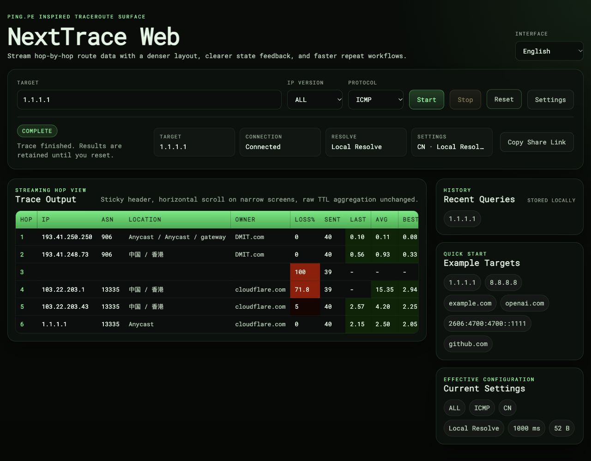
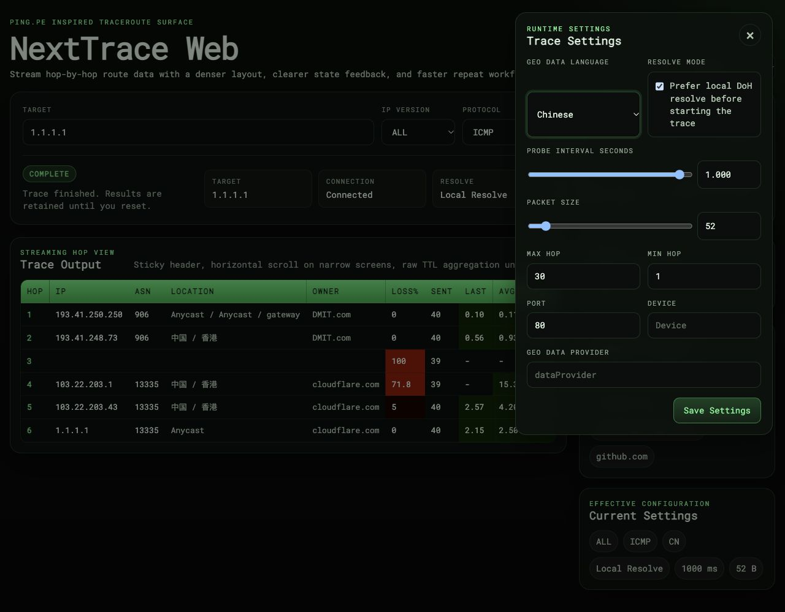

# NextTrace Web

**English** | [简体中文](README.zh-CN.md)

[](https://github.com/nxtrace/nexttraceweb/actions/workflows/docker-image.yml)
[](https://hub.docker.com/r/tsosc/nexttraceweb)
[](LICENSE)

Continuous traceroute from your browser, for private diagnostics or a public Looking Glass. Built on [NextTrace](https://github.com/nxtrace/NTrace-core), with an interface inspired by [PING.PE](https://ping.pe).



<details>
<summary>View the settings panel</summary>



</details>

## Features

- IPv4 / IPv6 with ICMP, TCP and UDP. Enter an IP, domain or URL and select among resolved addresses.
- Per-hop IP, ASN, location, owner, loss, sent count, latest / average / best / worst latency, standard deviation and PTR.
- HTTP task control and SSE statistics. Refreshes and short disconnects resume the same process; stopping retains received results.
- English and Simplified Chinese, independent interface and GeoIP languages, browser-local preferences and recent queries.
- Optional public mode enforcing target, concurrency, probe, duration and connection limits on the server.

## Quick start

Use Docker Engine on Linux. Images support `linux/amd64` and `linux/arm64`. This example listens only on localhost for initial testing.

```bash
umask 077
printf 'NTWA_SECRET_KEY=%s\n' "$(openssl rand -hex 32)" > .env

docker pull tsosc/nexttraceweb:latest
docker run -d --name ntwa --restart unless-stopped \
  --network host --cap-drop ALL --cap-add NET_RAW \
  --read-only --tmpfs /tmp:rw,nosuid,noexec,size=64m \
  --memory 512m --cpus 1 --pids-limit 128 \
  --ulimit nofile=1024:1024 \
  --log-driver local --log-opt max-size=10m --log-opt max-file=3 \
  --env-file .env tsosc/nexttraceweb:latest 127.0.0.1:30080
```

Open <http://127.0.0.1:30080/>. For a remote server, forward the port with `ssh -L 30080:127.0.0.1:30080 user@server`.

The image runs as UID `10001`; only the NextTrace executable has the `NET_RAW` file capability. Neither `--privileged` nor `NET_ADMIN` is needed. Do not enable a `no-new-privileges` setting that prevents the file capability from taking effect. Host networking preserves the probe node's routing.

The final argument selects the listener: `127.0.0.1:30080` for localhost, `30080` for all IPv4 / IPv6 addresses, or `'[::1]:30080'` for IPv6 localhost. Use an unprivileged port. The default health check uses `30080`; override its command if you change that port.

## Public Looking Glass

Public mode is off by default. Before accepting anonymous visitors, configure a domain and an HTTPS reverse proxy, then use the following `.env` with the run command above. Recreate an existing container to load changed environment variables.

```bash
umask 077
cat > .env <<EOF
NTWA_PUBLIC_MODE=true
NTWA_SECRET_KEY=$(openssl rand -hex 32)
NTWA_TRUSTED_HOSTS=trace.example.com,127.0.0.1,localhost
NTWA_SESSION_COOKIE_SECURE=true
NTWA_TRUSTED_PROXIES=127.0.0.1/32,::1/128
EOF
```

Replace `trace.example.com` with your domain. The proxy ranges assume a same-host reverse proxy; use the exact proxy IPs/CIDRs for other topologies. `127.0.0.1` allows the container health check. Keep the random secret stable, at least 32 characters long, and out of source control.

| Item | Public-mode limit |
| --- | --- |
| Targets | Public unicast only; blocks local, private, special and selected IPv6 transition addresses. Intermediate hops remain visible |
| Tasks | At most 4 globally, 1 per session and per IPv4 / IPv6 `/64` |
| Duration | At most 120 seconds; stops after 30 seconds without lease renewal |
| Probes | At least 1 second between sends to the same hop, at most 30 hops and 512-byte packets |
| Probe budget | At most 120 reserved probes/second across TTL spans and intervals; not egress shaping |
| Creation rate | One token per client and target every 10 seconds, burst 2; retries of the same request remain idempotent |
| SSE | 2 subscriptions per task, 4 per client, 32 globally |
| Resolution | 1 concurrent request per client, 4 globally, at most 16 candidate addresses |
| Data | 8 KiB requests; terminal records pruned by 5-minute retention and a 256-record cap; bounded output |

Excessive settings are rejected, including saved browser preferences. For example, an old `40ms` interval must be changed to at least `1s`. Public health responses expose only status, the devices endpoint exposes only the administrator's fixed interface, and native error details stay private.

### HTTPS reverse proxy

Add this to an Nginx HTTPS `server` with certificates already configured:

```nginx
location / {
    proxy_http_version 1.1;
    proxy_set_header Host $http_host;
    proxy_set_header X-Forwarded-For $remote_addr;
    proxy_set_header X-Forwarded-Proto $scheme;
    proxy_set_header Connection "";
    proxy_buffering off;
    proxy_read_timeout 60s;
    proxy_pass http://127.0.0.1:30080;
}
```

Overwrite forwarding headers and trust only configured proxies. SSE does not use WebSockets or require `Upgrade`. The server sends idle keepalives every 10 seconds; allow at least 25 seconds between reads at the outer proxy. Add Basic Auth or other gateway authentication for restricted access if needed.

### Sub-path deployment

To mount at `/tools/nexttrace/`, replace the `location /` above with these two blocks. Strip the prefix, retain both trailing slashes, and preserve query parameters in the redirect.

```nginx
location = /tools/nexttrace {
    return 301 /tools/nexttrace/$is_args$args;
}

location /tools/nexttrace/ {
    proxy_http_version 1.1;
    proxy_set_header Host $http_host;
    proxy_set_header X-Forwarded-For $remote_addr;
    proxy_set_header X-Forwarded-Proto $scheme;
    proxy_set_header Connection "";
    proxy_buffering off;
    proxy_read_timeout 60s;
    proxy_pass http://127.0.0.1:30080/;
}
```

Use a dedicated probe node and IPv4 / IPv6 egress rules to isolate local and management networks. Nodes behind NAT should add their own public addresses to the deny list. Application quotas do not replace upstream DDoS protection.

## Configuration

Environment variables are loaded at startup. Recreate the container after changing `.env`.

| Variable | Default / purpose |
| --- | --- |
| `NTWA_PUBLIC_MODE` | `false`; enables public mode |
| `NTWA_SECRET_KEY` | Generated temporarily if missing in normal mode; public mode requires an explicit value of at least 32 characters |
| `NTWA_TRUSTED_HOSTS` | Empty in normal mode; required in public mode; comma-separated hostnames or IPs |
| `NTWA_SESSION_COOKIE_SECURE` | `false` in normal mode, `true` in public mode; explicitly disable only for local HTTP tests |
| `NTWA_TRUSTED_PROXIES` | Outer proxy IPs/CIDRs; empty by default; comma-separated |
| `NTWA_MAX_ACTIVE_TRACES` | `64` in normal mode; public mode caps at `4` and permits tighter limits |
| `NTWA_MIN_START_INTERVAL_SECONDS` | Per-session creation cooldown of `1` second; at least `2` in public mode |
| `NTWA_TRACE_MAX_DURATION_SECONDS` | `0` means unlimited in normal mode; at most `120` seconds in public mode, with tighter limits allowed |
| `NTWA_TRACE_IDLE_TIMEOUT_SECONDS` | `120` seconds without native output; `0` disables this check |
| `NTWA_PUBLIC_DENY_CIDRS` | Additional blocked target IPs/CIDRs; empty by default; comma-separated |
| `NTWA_PUBLIC_DEVICE` | Fixed probe interface; defaults to system routing; visitors cannot select another interface |
| `NTWA_PUBLIC_TCP_PORTS` | `80,443`; first entry used when omitted |
| `NTWA_PUBLIC_UDP_PORTS` | `80,443,33494`; first entry used when omitted; ICMP ignores ports |
| `NTWA_NEXTTRACE_PATH` | `/usr/local/bin/nexttrace` |
| `NTWA_NEXTTRACE_FLAVOR` | `nexttrace` outside Docker; `ntr` in the default image |
| `NTWA_LOG_LEVEL` | `INFO` |

Normal mode retains existing parameter ranges and saved intervals. The default 1-second interval is **between sends to the same hop**. Hops advance independently; it is not one global interval shared by all probes.

## Usage and operation

- **Refresh and reconnect:** the browser renews every 10 seconds and can resume within the 30-second lease window. Task IDs live in `sessionStorage`; ownership is checked against the session cookie.
- **Stop and reset:** stopping retains received results; resetting clears the current results and target. Share links contain only the target, without a results snapshot.
- **Language and resolution:** interface language can follow browser preferences; GeoIP language is independent. Both browser DoH and server-side resolution are supported.
- **State:** use one Gunicorn gevent worker. Tasks and request deduplication are in memory, do not survive restarts and are not shared across instances.
- **Processes:** stopping sends SIGTERM, then forces cleanup after 2 seconds if needed. The container exits when Gunicorn or Nginx exits.

```bash
curl -fsS http://127.0.0.1:30080/healthz
docker logs --tail 100 ntwa
```

| Symptom | Check |
| --- | --- |
| Public requests are rejected | HTTPS, allowed Host values, trusted proxy sources and forwarding headers |
| Saved settings cannot start a trace | Public limits: interval at least 1 second, at most 30 hops / 512 bytes, restricted interfaces and ports |
| Delayed results or frequent disconnects | Disable SSE buffering at every proxy and allow at least 25 seconds between reads |
| Native executable permission failure | Retain `NET_RAW`; avoid `--privileged` and a `no-new-privileges` setting that blocks file capabilities |
| Task missing after restart | In-memory state was released; start a new query |

## Source and API

The backend uses Flask with Gunicorn/gevent; the frontend uses native JavaScript modules without a build step. CI covers Python 3.12 / 3.14, Node 24, both image architectures and public-mode container acceptance.

For local development, install NextTrace v1.7.5 or a compatible later version and provide the required probe permissions:

```bash
python3.14 -m venv .venv
. .venv/bin/activate
pip install -r requirements.txt
export NTWA_NEXTTRACE_PATH=/path/to/ntr
export NTWA_NEXTTRACE_FLAVOR=ntr
export NTWA_SECRET_KEY="$(openssl rand -hex 32)"
gunicorn --config gunicorn.conf.py --worker-class gevent --workers 1 \
  --bind 127.0.0.1:35000 app:app
```

| Endpoint | Purpose |
| --- | --- |
| `POST /api/traces/resolve` | Resolve candidates without starting a process |
| `POST /api/traces` | Create from an explicit IP, `extra` settings and `request_id`; returns `task_id` |
| `GET /api/traces/{task_id}` | Current state and full statistics snapshot |
| `GET /api/traces/{task_id}/events` | SSE snapshots with increasing `seq` |
| `POST /api/traces/{task_id}/lease` | Renew the lease |
| `POST /api/traces/{task_id}/stop` | Idempotent stop |
| `GET /api/devices` | Available interfaces; only the configured interface in public mode |
| `GET /healthz` | Service and native binary availability |

Keep session cookies when calling task endpoints; POST bodies are JSON. The backend aggregates probe events by TTL and publishes running snapshots at most once per 100ms; first subscriptions, reconnects and terminal states receive immediate snapshots. These statistics are separate from native multi-responder reports.

Build locally with `docker build -t nexttraceweb:local .`. Defaults are `v1.7.5` and flavor `ntr`; override with `NEXTTRACE_RELEASE_TAG` and `NEXTTRACE_ASSET_PREFIX` (`ntr`, `nexttrace`, `nexttrace-tiny`). Downloads are verified against committed SHA256 values, GitHub release digests or an explicit `NEXTTRACE_SHA256`. Missing or mismatched digests fail the build. Published images use a release tag resolved and fixed by CI.

`ntr` uses `--json`; full / tiny use `--mtr --json`. [MTR JSON schema version 1](https://github.com/nxtrace/NTrace-core/blob/v1.7.5/docs/mtr-json.md) is required. Unsupported binaries fail explicitly, without falling back to RAW mode.

## License

[GPL-3.0](LICENSE). Thanks to the NextTrace community and PING.PE.
