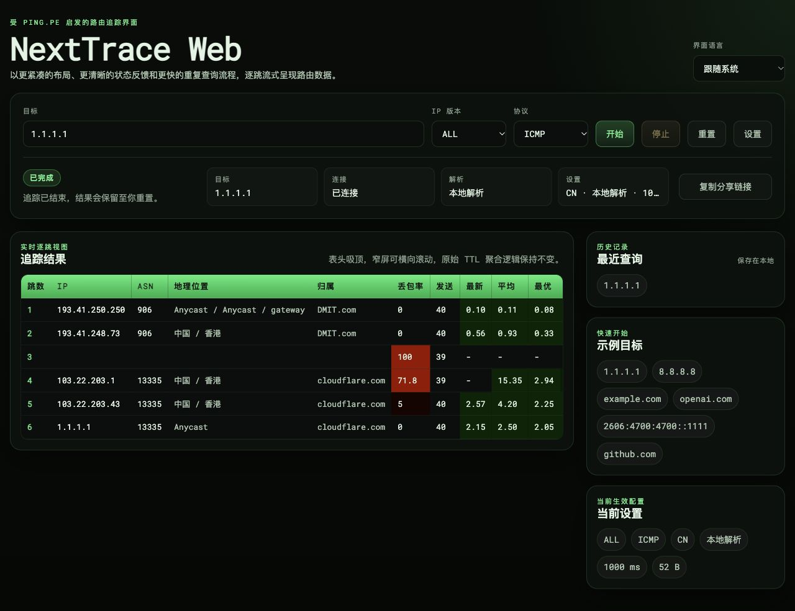
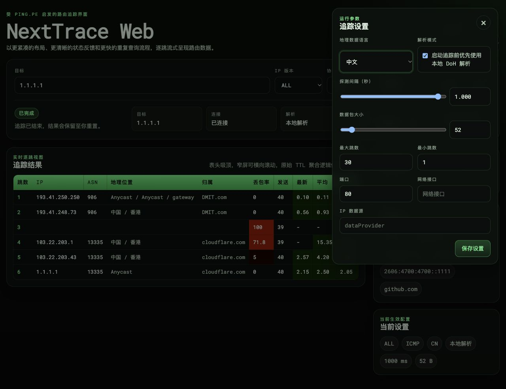

# NextTrace Web

[English](README.md) | **简体中文**

[](https://github.com/nxtrace/nexttraceweb/actions/workflows/docker-image.yml)
[](https://hub.docker.com/r/tsosc/nexttraceweb)
[](LICENSE)

在浏览器中运行持续路由探测，可用于自用诊断或公开 Looking Glass。基于 [NextTrace](https://github.com/nxtrace/NTrace-core)，界面设计受 [PING.PE](https://ping.pe) 启发。



<details>
<summary>查看设置面板</summary>



</details>

## 功能

- IPv4 / IPv6，支持 ICMP、TCP、UDP；可输入 IP、域名或 URL，并选择解析结果。
- 按跳显示 IP、ASN、位置、归属、丢包、发送量、最新／平均／最优／最差延迟、标准差及 PTR。
- HTTP 控制任务，SSE 推送统计；刷新和短暂断线可续接同一进程，停止后保留结果。
- 英文和简体中文界面；界面语言与地理数据语言独立，最近查询和偏好保存在浏览器中。
- 可选公开模式，在服务端限制目标、并发、探测参数、运行时长和连接数。

## 快速启动

推荐在 Linux 上使用 Docker Engine，镜像支持 `linux/amd64` 和 `linux/arm64`。以下配置仅监听本机，适合先验证功能。

```bash
umask 077
printf 'NTWA_SECRET_KEY=%s\n' "$(openssl rand -hex 32)" > .env

docker pull tsosc/nexttraceweb:latest
docker run -d --name ntwa --restart unless-stopped \
  --network host --cap-drop ALL --cap-add NET_RAW \
  --read-only --tmpfs /tmp:rw,nosuid,noexec,size=64m \
  --memory 512m --cpus 1 --pids-limit 128 \
  --ulimit nofile=1024:1024 \
  --log-driver local --log-opt max-size=10m --log-opt max-file=3 \
  --env-file .env tsosc/nexttraceweb:latest 127.0.0.1:30080
```

打开 <http://127.0.0.1:30080/>。远程机器可使用 SSH 转发：`ssh -L 30080:127.0.0.1:30080 user@server`。

镜像以 UID `10001` 运行，只有 NextTrace 可执行文件持有 `NET_RAW`。不需要 `--privileged` 或 `NET_ADMIN`；不要添加会阻止文件能力生效的 `no-new-privileges`。host 网络用于保留探测节点的实际路由。

镜像后的参数决定监听地址：`127.0.0.1:30080` 仅本机，`30080` 监听所有 IPv4 / IPv6 地址，`'[::1]:30080'` 仅 IPv6 本机。使用非特权端口；默认健康检查访问 `30080`，更换端口时需同步覆盖健康检查命令。

## 公开 Looking Glass

公开模式默认关闭。对匿名访客开放时，先配置域名和 HTTPS 反代，再使用下面的 `.env` 执行上方启动命令。已有容器需要重新创建才能加载新环境变量。

```bash
umask 077
cat > .env <<EOF
NTWA_PUBLIC_MODE=true
NTWA_SECRET_KEY=$(openssl rand -hex 32)
NTWA_TRUSTED_HOSTS=trace.example.com,127.0.0.1,localhost
NTWA_SESSION_COOKIE_SECURE=true
NTWA_TRUSTED_PROXIES=127.0.0.1/32,::1/128
EOF
```

把 `trace.example.com` 替换为实际域名。代理网段示例适用于同机反代；其他拓扑需填写真实代理的准确 IP/CIDR。`127.0.0.1` 用于容器健康检查。密钥应保持固定，至少 32 字符，不要提交到仓库。

| 项目 | 公开模式限制 |
| --- | --- |
| 目标 | 仅公网单播，拒绝本机、内网、特殊及部分 IPv6 过渡地址；中间跳点正常显示 |
| 任务 | 全局最多 4 个，每会话及每 IPv4 / IPv6 `/64` 最多 1 个 |
| 时长 | 最长 120 秒；连续 30 秒未续租则停止 |
| 参数 | 同一跳发送间隔至少 1 秒，最多 30 跳，包大小最多 512 字节 |
| 探测预算 | 按跳数范围与间隔计算，合计最多预留 120 次／秒，不等同于出口整形 |
| 创建频率 | 每客户端和每目标每 10 秒补充 1 次额度，允许突发 2 次；相同请求重试不重复启动 |
| SSE | 每任务 2 个、每客户端 4 个、全局 32 个订阅 |
| 解析 | 每客户端 1 个、全局 4 个并发，最多 16 个候选地址 |
| 数据 | 请求最多 8 KiB；终态记录按 5 分钟及 256 条上限清理，输出长度受限 |

超限设置会被拒绝，浏览器保存的旧设置同样受限；例如旧的 `40ms` 间隔需改为至少 `1s`。公开模式的健康检查只返回状态，网卡接口只返回管理员固定的网卡，原生错误详情不向访客披露。

### HTTPS 反代

在已配置证书的 Nginx HTTPS `server` 中加入：

```nginx
location / {
    proxy_http_version 1.1;
    proxy_set_header Host $http_host;
    proxy_set_header X-Forwarded-For $remote_addr;
    proxy_set_header X-Forwarded-Proto $scheme;
    proxy_set_header Connection "";
    proxy_buffering off;
    proxy_read_timeout 60s;
    proxy_pass http://127.0.0.1:30080;
}
```

覆盖转发头，并只信任配置过的代理。SSE 不使用 WebSocket，不需要 `Upgrade`。服务端每 10 秒发送空闲保活，外层读超时应至少 25 秒。自用服务如需登录，可在外层添加 Basic Auth 等鉴权。

### 二级路径

挂载在 `/tools/nexttrace/` 时，用下面两段替换上方的 `location /`。反代必须剥离前缀，两个结尾斜杠都要保留；跳转也需保留查询参数。

```nginx
location = /tools/nexttrace {
    return 301 /tools/nexttrace/$is_args$args;
}

location /tools/nexttrace/ {
    proxy_http_version 1.1;
    proxy_set_header Host $http_host;
    proxy_set_header X-Forwarded-For $remote_addr;
    proxy_set_header X-Forwarded-Proto $scheme;
    proxy_set_header Connection "";
    proxy_buffering off;
    proxy_read_timeout 60s;
    proxy_pass http://127.0.0.1:30080/;
}
```

建议使用专用探测节点，并为 IPv4 / IPv6 配置出口规则，隔离本机和管理网络。位于 NAT 后的节点应把自身公网地址加入禁止列表；应用限额不能替代上游 DDoS 防护。

## 配置参考

环境变量在启动时加载；修改 `.env` 后需重新创建容器。

| 变量 | 默认值 / 用途 |
| --- | --- |
| `NTWA_PUBLIC_MODE` | `false`；启用公开模式 |
| `NTWA_SECRET_KEY` | 普通模式缺失时临时生成；公开模式必须显式提供至少 32 字符 |
| `NTWA_TRUSTED_HOSTS` | 普通模式为空；公开模式必填，域名或 IP 以逗号分隔 |
| `NTWA_SESSION_COOKIE_SECURE` | 普通模式 `false`，公开模式 `true`；仅本地 HTTP 测试时显式关闭 |
| `NTWA_TRUSTED_PROXIES` | 外层可信代理 IP/CIDR，默认无；逗号分隔 |
| `NTWA_MAX_ACTIVE_TRACES` | 普通模式 `64`；公开模式上限 `4`，可进一步收紧 |
| `NTWA_MIN_START_INTERVAL_SECONDS` | 同一会话创建冷却 `1` 秒；公开模式至少 `2` 秒 |
| `NTWA_TRACE_MAX_DURATION_SECONDS` | 普通模式 `0` 表示不限；公开模式最多 `120` 秒，可进一步收紧 |
| `NTWA_TRACE_IDLE_TIMEOUT_SECONDS` | 无原生输出超时 `120` 秒；`0` 关闭此检查 |
| `NTWA_PUBLIC_DENY_CIDRS` | 额外禁止的目标 IP/CIDR，默认空；逗号分隔 |
| `NTWA_PUBLIC_DEVICE` | 固定探测网卡；默认使用系统路由，访客不能改选其他网卡 |
| `NTWA_PUBLIC_TCP_PORTS` | `80,443`；缺省使用第一项 |
| `NTWA_PUBLIC_UDP_PORTS` | `80,443,33494`；缺省使用第一项；ICMP 忽略端口 |
| `NTWA_NEXTTRACE_PATH` | `/usr/local/bin/nexttrace` |
| `NTWA_NEXTTRACE_FLAVOR` | 源码运行默认 `nexttrace`；默认 Docker 镜像为 `ntr` |
| `NTWA_LOG_LEVEL` | `INFO` |

普通模式保留原有参数范围与已保存的间隔。界面默认间隔为 1 秒，表示**同一跳两次发送的间隔**，各跳独立推进，不是所有探针共用的全局发送间隔。

## 使用与运行

- **刷新与断线：** 页面每 10 秒续租，30 秒内恢复可继续原任务。任务 ID 保存在 `sessionStorage`，所属会话由 Cookie 校验。
- **停止与重置：** 停止保留已接收结果，重置清空当前结果和目标。分享链接只携带目标，不包含结果快照。
- **语言与解析：** 界面可自动跟随浏览器语言，地理数据语言单独设置；支持浏览器 DoH 和服务端解析。
- **状态：** 使用一个 Gunicorn gevent worker，任务及去重记录在内存中；服务重启后不恢复旧任务，多实例不共享配额。
- **进程：** 停止先发送 SIGTERM，2 秒后仍未退出则强制回收；Gunicorn 或 Nginx 退出会带动容器退出。

```bash
curl -fsS http://127.0.0.1:30080/healthz
docker logs --tail 100 ntwa
```

| 现象 | 检查项 |
| --- | --- |
| 公开模式请求被拒绝 | HTTPS、Host 白名单、代理来源和转发头是否一致 |
| 保存过的参数无法启动 | 公开模式间隔至少 1 秒，最多 30 跳、512 字节；网卡及端口受限 |
| 结果延迟、断线频繁 | 每一层反代都关闭 SSE 缓冲，读超时至少 25 秒 |
| 原生进程无权限执行 | 保留 `NET_RAW`，避免 `--privileged` 和阻断文件能力的 `no-new-privileges` |
| 重启后任务不存在 | 内存状态已释放，重新开始查询 |

## 源码与接口

后端为 Flask + Gunicorn/gevent，前端为原生 JavaScript 模块，无前端打包步骤。CI 覆盖 Python 3.12 / 3.14、Node 24、双架构构建和公开模式容器验收。

本地运行需先安装 NextTrace v1.7.5 或后续兼容版本，并为探测进程提供所需权限：

```bash
python3.14 -m venv .venv
. .venv/bin/activate
pip install -r requirements.txt
export NTWA_NEXTTRACE_PATH=/path/to/ntr
export NTWA_NEXTTRACE_FLAVOR=ntr
export NTWA_SECRET_KEY="$(openssl rand -hex 32)"
gunicorn --config gunicorn.conf.py --worker-class gevent --workers 1 \
  --bind 127.0.0.1:35000 app:app
```

| 接口 | 用途 |
| --- | --- |
| `POST /api/traces/resolve` | 解析候选地址，不启动进程 |
| `POST /api/traces` | 使用明确 IP、`extra` 设置和 `request_id` 创建任务，返回 `task_id` |
| `GET /api/traces/{task_id}` | 当前状态及完整统计快照 |
| `GET /api/traces/{task_id}/events` | SSE 快照流，携带递增 `seq` |
| `POST /api/traces/{task_id}/lease` | 续租 |
| `POST /api/traces/{task_id}/stop` | 幂等停止 |
| `GET /api/devices` | 可用网卡；公开模式只显示管理员配置 |
| `GET /healthz` | 服务及原生二进制可用性 |

任务接口需要保留会话 Cookie；POST 使用 JSON。后端按 TTL 聚合逐探针事件，运行中快照最多每 100ms 推送一次；首次订阅、重连和终态立即发送。这与原生多响应者报告的统计口径不同。

自建镜像：`docker build -t nexttraceweb:local .`。默认构建版本 `v1.7.5`、flavor `ntr`；可用 `NEXTTRACE_RELEASE_TAG` 和 `NEXTTRACE_ASSET_PREFIX` 调整，后者支持 `ntr`、`nexttrace`、`nexttrace-tiny`。下载使用仓库内固定 SHA256、GitHub 发布摘要或显式传入的 `NEXTTRACE_SHA256` 校验；缺失或不匹配时构建失败。发布镜像的版本由 CI 解析发布标签后固定。

`ntr` 使用 `--json`，full / tiny 使用 `--mtr --json`，要求 [MTR JSON schema version 1](https://github.com/nxtrace/NTrace-core/blob/v1.7.5/docs/mtr-json.md)。不支持的二进制会报错，不回退 RAW 模式。

## 许可证

[GPL-3.0](LICENSE)。感谢 NextTrace 社区与 PING.PE。
